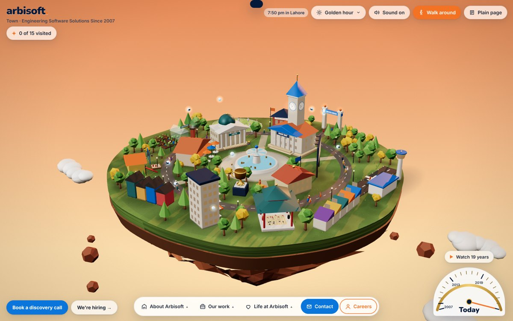
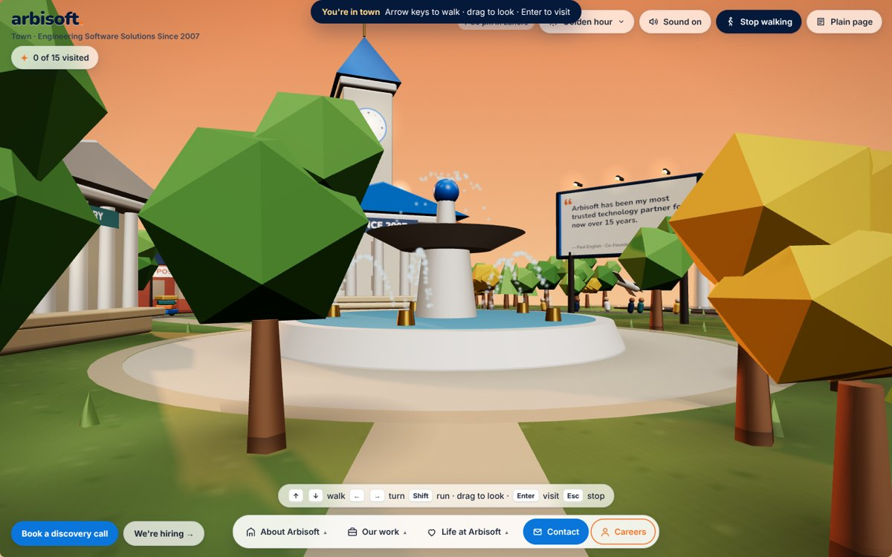

# 3D Portfolio Builder

**A Claude skill that builds a portfolio people play with instead of read.** By [Aimen Khalid](https://aimenkhalid.netlify.app/).

Give it your story and it builds you a full-screen world. It might be a lit desk, a room you walk into, a tiny town, or a book that turns its pages. Every object in it holds a piece of your work. The world has real light that changes through the day, sound, a little game to finish, hidden secrets, and one big "wow" moment. The goal: visitors go "wow" in the first five seconds and keep exploring for five minutes.



## How it works

1. **It asks you a few questions, one at a time.** Who the site is for, what you do, who should visit and what they should do next. It also asks for your résumé or LinkedIn and the projects you're proudest of. Then it sends one optional list of personal questions (hobbies, objects you keep, the time of day that feels like you) so you can answer only the ones you like. Share whatever you have. It builds from that and never makes things up.
2. **It suggests 2-3 worlds made for you.** Each comes with a one-line pitch, how your content maps onto objects, the lighting idea and the wow moment. Pick one, mix two, or bring your own idea.
3. **It confirms a short concept sheet.** It lists what visitors see first, which object holds what, the game, the secrets, the light and the sound.
4. **It builds the site where you can watch it grow.** You get a live page early, and it updates as each part lands.
5. **It checks its own work.** It walks through the whole site the way a visitor would, with real mouse, keyboard and touch input. It takes screenshots at desktop and phone sizes and runs an automated **flicker audit**, so no surface shimmers or z-fights. Then it scores the site against a "wow" rubric and keeps improving it until it passes.
6. **It asks what you think,** iterates on your feedback, and can deploy the finished site to Netlify so you have a link to share.

The result is a single self-contained `index.html` you can host anywhere.

## What every site gets

- **Real light and depth.** Real-time 3D or a lit scene, with shadows, and time-of-day presets that open on the visitor's clock.
- **Your story, easy to find.** Every key part of it (each role, project, award or talk) gets its own object, place or chapter.
- **Depth when you open something.** Objects come closer and turn over, and their backs look like real backs.
- **A game.** A "✦ 3 of 10 found" tracker, at least three hidden secrets that also work on touch screens, and a reward for finding everything.
- **One big, reversible wow moment.**
- **Procedural sound,** with an on/off toggle.
- **A plain page** with all the content, for accessibility and for browsers without 3D.
- **A real phone layout,** not a shrunk desktop.
- **Zero flicker,** checked by an automated audit before handover.

## Built with it

| # | Site | Kind of world | Link |
|---|---|---|---|
| 1 | Badge rail: lanyard badges that swing, flip and play notes | Tactile playground | [aimenkhalid.netlify.app](https://aimenkhalid.netlify.app/) |
| 2 | Cozy room: an orbitable room where each piece of furniture is a section | Walk-in space | [aimenkhalid.netlify.app/v2](https://aimenkhalid.netlify.app/v2/) |
| 3 | Cupboard: drawers you open, with a mischievous cat | Walk-in space | [aimenkhalid.netlify.app/v3](https://aimenkhalid.netlify.app/v3/) |
| 4 | Aimen's Desk: a top-down desk under low sun through a carved lattice | Lit flat-lay | [aimenkhalid.netlify.app/v4](https://aimenkhalid.netlify.app/v4/) |
| 5 | Arbisoft Town: a floating 3D town where every building sends you a postcard. You can watch 19 years of growth or walk it in first person | Miniature world | [aimenkhalid.netlify.app/arbisoft](https://aimenkhalid.netlify.app/arbisoft/) |

Sites 1-4 are versions of my own portfolio. Arbisoft Town shows the skill building for a company instead of a person.



## Install

The skill is the [`playful-portfolio-builder/`](playful-portfolio-builder/) folder:

```
playful-portfolio-builder/
├── SKILL.md              # the instructions Claude follows
├── references/           # techniques, loaded only when a step needs them
└── assets/quality-bar/   # close-up craft references for the self-review
```

- **Claude Code:** copy the folder into `~/.claude/skills/` (or `.claude/skills/` inside a project).
- **Claude apps:** zip the `playful-portfolio-builder` folder and add it as a custom skill.

Then ask for something like *"Make me a playful portfolio"* or *"Build an interactive portfolio site for me."*
